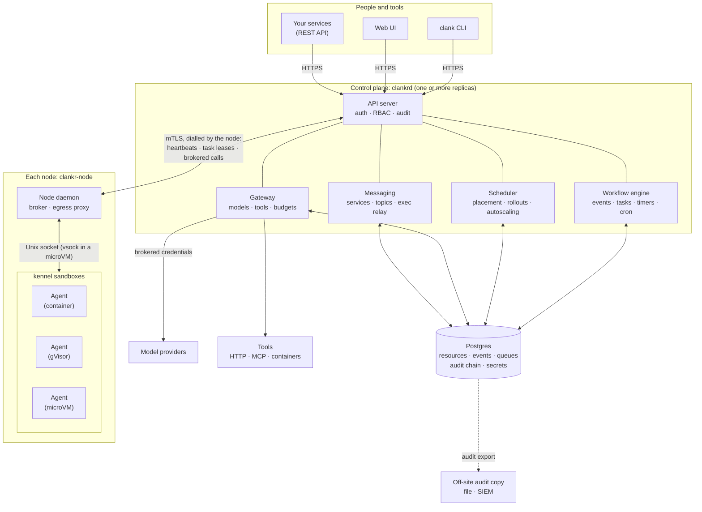
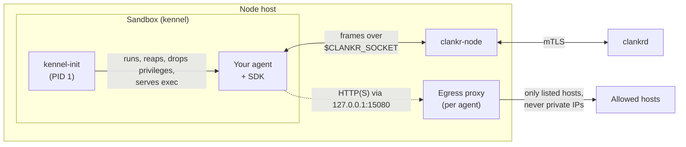
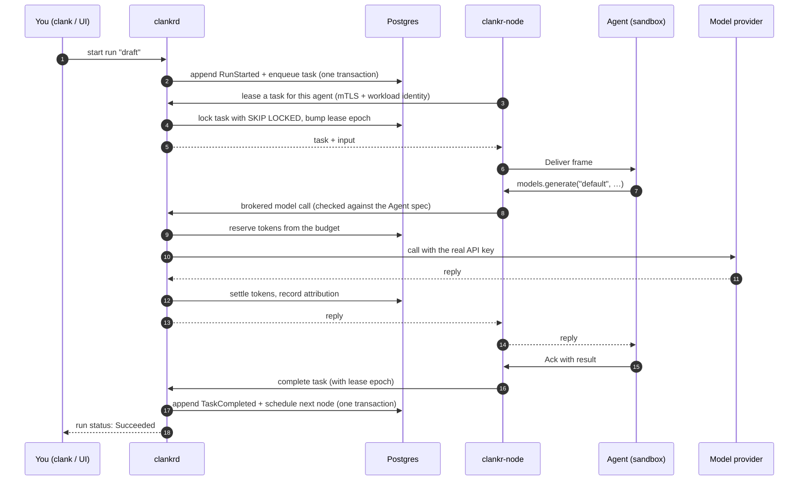

<p align="center">
  <picture>
    <source media="(prefers-color-scheme: dark)" srcset="docs/assets/clankr-dark.svg">
    
  </picture>
</p>

<p align="center">
  An orchestration engine for AI agents, written in Rust.<br>
  Sandboxed agents, durable workflows, and a gateway between your agents and everything they touch.
</p>

<p align="center">
  <a href="#quick-start">Quick start</a> ·
  <a href="#how-it-fits-together">Architecture</a> ·
  <a href="#writing-an-agent">Writing an agent</a> ·
  <a href="#the-resource-model">Resources</a> ·
  <a href="#security">Security</a> ·
  <a href="docs/adr">Design notes</a>
</p>

> [!NOTE]
> Clankr is early (0.1.0). It works end to end and every feature below is covered by integration tests, but APIs and schemas will still change.

---

## The short version

You describe agents and workflows as resources, much as you would with Kubernetes. Clankr runs each agent in a sandbox on one of your machines, records every step of every workflow in Postgres, and stands between your agents and the outside world:

- **Every model call** goes through a gateway that holds the API keys, enforces budgets and records who spent what.
- **Every tool call** is checked against grants, deduplicated on retry, and can wait for a human to approve it.
- **Every message between agents** is durable, authenticated and delivered at least once.
- **Every privileged action** lands in a hash-chained audit log you can ship off-site.

There's no Kubernetes and no Temporal underneath: one control-plane binary on Postgres, and a small daemon on each machine that runs agents.

<table>
<tr>
<td width="50%" valign="top">

**An agent** (Python; TypeScript and Go work the same way)

```python
from clankr import AgentApp

app = AgentApp()

@app.task("draft")
async def draft(task, ctx):
    topic = task.input["input"]["topic"]
    reply = await ctx.models.generate(
        "default",
        [{"role": "user", "content": topic}],
    )
    text = reply["text"]
    review = await ctx.services.call(
        "reviewer", {"text": text})
    return {"draft": text, "review": review}

app.run()
```

</td>
<td width="50%" valign="top">

**What it's allowed to do** (everything else is refused)

```yaml
kind: Agent
metadata: { name: writer, namespace: blog }
spec:
  runtime:
    type: oci
    image: blog/writer@sha256:…
    class: gvisor  # or container, microvm
  # claims and services, never API keys
  models: [default]
  calls: [reviewer]
  egress: ["api.example.com:443"]
  resources: { memoryMiB: 512, cpus: 1 }
  restartPolicy:
    maxRestarts: 5
    windowSeconds: 600
```

</td>
</tr>
</table>

---

## Why it exists

Getting one agent working in a notebook is easy. Running many of them for real raises problems that no single agent should have to solve:

| The problem | What Clankr does about it |
|---|---|
| Agents crash, nodes die, models time out, and a three-hour job shouldn't start over. | Workflow state is event-sourced in Postgres. Each step commits in the same transaction as the work it schedules, so a crash anywhere resumes exactly where it stopped. |
| Agents run code you didn't write: packages, browsers, tools. | Each agent runs in a rootless container, a gVisor sandbox or a Firecracker microVM: read-only, unprivileged, with no network unless you grant it. |
| A runaway loop can spend a month's budget in an afternoon. | Tokens are reserved from a budget before every model call and settled after it, per namespace and per run. |
| Some actions need a person: publishing, paying, deleting. | Approval steps and approval-gated tools wait in an inbox and record who said yes. |
| When something goes wrong, you need to know exactly what happened. | Every run has a full event history you can view at any point, or fork from. Every privileged action is in a tamper-evident audit log. |

---

## What's in the box

<table>
<tr>
<td width="50%" valign="top">

### Workflows
- Declarative graphs: agent steps, tool calls, conditions, joins, timers, signals and human approvals.
- Event-sourced and exactly resumable. Replay never calls a model or tool again.
- Time travel: inspect a run as it stood after any event, or fork a new run from there.
- **Cron jobs** start runs on a schedule, and **event triggers** start them when a message is published.

### Sandboxes
- Three isolation levels via [kennel](#related-projects): container, gVisor, Firecracker microVM.
- No network by default. Listed hosts are reached through a per-agent proxy, or a policy-gated NAT mode that logs every connection.
- Signed-image policies (cosign-compatible), volumes, resource limits.
- **Restart budgets:** a crash-looping agent stops being restarted, and its deployment says why.

### Messaging
- **Services:** a stable name like `clankr://agents/blog/reviewer`, served by every instance of an agent.
- **Request/reply** with timeouts: a request nobody picked up in time expires unprocessed, and a late reply never comes back to haunt a caller.
- **Topics** with durable subscriptions, so a subscriber that was down catches up.
- SDK handlers receive messages for you. There's no polling loop to write.

</td>
<td width="50%" valign="top">

### Gateway
- Agents never hold credentials. They name a claim, and the gateway brokers the real key.
- OpenAI-compatible and Anthropic adapters, with budgets and attribution.
- Tools: HTTP endpoints, sandboxed containers, MCP servers. Each has grants, input schemas, idempotent replay and optional approval.

### Fleet
- Nodes join with a token and mutual TLS. The scheduler places agents on them.
- Rolling updates, canaries, autoscaling from queue depth (to zero and back), hibernation and node drains.
- Several control-plane replicas can share one Postgres, and runs can be placed on other clusters.
- `clank exec`: an audited shell inside any running agent, from anywhere.

### Governance
- Role-based access control, ServiceAccount tokens, and OIDC sign-in.
- Quotas, budgets and alerts per namespace.
- A hash-chained audit log, shipped off-site and checked against the database on demand.
- Secrets are envelope-encrypted, and can use HashiCorp Vault as the key manager.

</td>
</tr>
</table>

Around all of that: the `clank` CLI, a web UI built into the control plane, SDKs for Python, TypeScript and Go, versioned shared memory with snapshots, evaluation suites that gate releases, image promotion through stages, OpenTelemetry tracing, and backups with verified restore.

---

## How it fits together

There are two kinds of process. The **control plane** (`clankrd`, one or more replicas) owns all decisions and all state, in Postgres. A **node daemon** (`clankr-node`) on each machine runs agents in sandboxes and brokers every call they make.



Four properties carry most of the weight:

1. **Nodes dial the control plane, never the reverse.** A node can sit behind NAT, and nothing ever needs credentials for it. Even `clank exec` works this way: the node picks up the session from its next heartbeat.
2. **Agents only talk to their own node,** over a socket mounted into the sandbox. The node checks every call against the agent's spec before forwarding it, so an agent that swaps out the SDK still can't reach anything it wasn't given.
3. **Postgres is the source of truth and the message bus.** Tasks are dispatched with `FOR UPDATE SKIP LOCKED`, wake-ups and message relays use `LISTEN/NOTIFY`, and leadership is a lease row. There's no broker to run.
4. **Every lease is fenced by an epoch.** A node that lost an instance, or a worker whose lease ran out, can't commit stale results: the database refuses the write.

<details>
<summary><b>Inside a node</b></summary>



`kennel-init` is a small static binary that runs as PID 1 in every sandbox. It drops the agent to an unprivileged user, forwards signals, reaps zombies and serves `kennel exec`. In a microVM it also boots the guest (network, modules, volumes) and relays the agent's socket over vsock.

</details>

<details>
<summary><b>One workflow step, end to end</b></summary>

Each arrow that changes state is a single Postgres transaction, so a crash between any two of them is safe.



A run's state is a fold over its events, which is why history views, time travel and forking never repeat a model or tool call.

</details>

---

## Quick start

<details open>
<summary><b>What you need</b></summary>

| | For | Notes |
|---|---|---|
| Linux | everything | Developed on Ubuntu 24.04+. Sandboxes use namespaces and cgroups v2. |
| Rust (stable, edition 2024) | building | `rustup` is the easy way. |
| kennel | running agents as images | The sister repository, checked out next to this one as `../kennel`. |
| AppArmor profile | Ubuntu 24.04+ | Ubuntu blocks unprivileged user namespaces by default. kennel ships `deploy/apparmor/kennel-dev`. |
| `pasta` | direct-network agents, microVM networking | From the `passt` package. |
| `runsc` / `firecracker` + a guest kernel | gVisor / microVM sandboxes | Optional. Set `KENNEL_VM_KERNEL` for microVMs. |
| Python 3, Node 22.18+ or Go 1.24 | writing agents | Only the SDK you use. |

You don't need to install Postgres: `clankrd --dev` runs a private one.

</details>

**1. Build** (with the `clankr` and `kennel` checkouts side by side)

```bash
cd kennel && cargo build && cargo build -p kennel-init --release --target x86_64-unknown-linux-musl
cd ../clankr && cargo build

# Ubuntu 24.04+: let kennel create user namespaces
sudo cp ../kennel/deploy/apparmor/kennel-dev /etc/apparmor.d/
sudo apparmor_parser -r /etc/apparmor.d/kennel-dev
```

**2. Start the control plane**

```bash
./target/debug/clankrd --dev
```

On first start it creates an embedded Postgres, a cluster CA, an owner token (`~/.config/clankr/token`), a node join token (`~/.config/clankr/join-token`), and a master key (`~/.local/share/clankr/master.key`). Then it serves the API and the web UI on `https://127.0.0.1:7600`.

> [!IMPORTANT]
> Back up `master.key`. Secrets can't be read without it (unless you've moved them onto a KMS).

**3. Add a node**

```bash
ln -s $PWD/target/debug/clank ~/.local/bin/clank      # the CLI finds the token and CA by itself
./target/debug/clankr-node --server https://127.0.0.1:7600 \
  --join-token "$(cat ~/.config/clankr/join-token)" \
  --ca-cert ~/.local/share/clankr/pki/ca.crt \
  --runtimes process,oci,oci/gvisor --kennel ../kennel/target/debug/kennel
clank nodes
```

```
NAME     STATUS   MEMORY   CPUS   RUNTIMES                  INSTANCES
laptop   Ready    4096Mi   2.0    process,oci,oci/gvisor    -
```

**4. Run something.** Save this as `hello.yaml`. It uses a mock model provider, so you don't need an API key:

```yaml
apiVersion: clankr.io/v1alpha1
kind: ProviderConnection
metadata: { name: mock, namespace: demo }
spec: { provider: mock, allowedModels: [mock-1] }
---
apiVersion: clankr.io/v1alpha1
kind: ModelClaim
metadata: { name: default, namespace: demo }
spec: { providerConnection: mock, model: mock-1 }
---
apiVersion: clankr.io/v1alpha1
kind: Agent
metadata: { name: writer, namespace: demo }
spec:
  runtime:
    type: process                       # quickest to try; not sandboxed
    command: [python3, /path/to/agent.py]
    env: { PYTHONPATH: /path/to/clankr/sdk/python }
  models: [default]
---
apiVersion: clankr.io/v1alpha1
kind: AgentDeployment
metadata: { name: writer, namespace: demo }
spec: { agent: writer, replicas: 1 }
---
apiVersion: clankr.io/v1alpha1
kind: Workflow
metadata: { name: hello, namespace: demo }
spec:
  entrypoint: draft
  nodes:
    draft: { type: agent, agentRef: writer }
```

```bash
clank apply -f hello.yaml
clank run start hello -n demo --input '{"topic": "durable agents"}'
clank run list -n demo
```

Open `https://127.0.0.1:7600` and paste your token to watch it in the UI. The browser will warn about the certificate, because your cluster's own CA signed it.

---

## Writing an agent

An agent is an ordinary program using a Clankr SDK. It registers handlers, and Clankr delivers work to them: workflow tasks, service requests, and messages from subscribed mailboxes.

<table>
<tr>
<td width="50%" valign="top">

**Python**

```python
from clankr import AgentApp, Permanent

app = AgentApp()

# every workflow node
@app.task("*")
async def work(task, ctx):
    return {"seen": task.node}

# request/reply: the return value is the reply
@app.service("reviewer")
async def review(msg, ctx):
    if not msg.payload.get("text"):
        raise Permanent("nothing to review")
    return {"ok": True}

# a mailbox an EventSubscription fills
@app.subscribe("orders")
async def on_order(msg, ctx):
    await ctx.publish("orders.seen", msg.payload)

app.run()
```

</td>
<td width="50%" valign="top">

**TypeScript** (Node 22.18+ runs `.ts` directly)

```ts
import { AgentApp, Permanent } from "@clankr/sdk"

new AgentApp()
  .task("*", async (task) => ({
    seen: task.node,
  }))
  .service("reviewer", async (msg) => {
    if (!msg.payload.text)
      throw new Permanent("nothing to review")
    return { ok: true }
  })
  .subscribe("orders", async (msg, ctx) => {
    await ctx.publish("orders.seen", msg.payload)
  })
  .run()
```

The Go SDK (`sdk/go`, standard library only) covers tasks, models, context, tools and mailboxes.

</td>
</tr>
</table>

**The rules of the road**

- **Delivery is at least once.** A task or message can arrive again after a crash or a timeout, so handlers must be safe to repeat. Tool calls made through `ctx.tools.call` get a stable idempotency key automatically, and a service replies to each request at most once.
- **Raise `Permanent`** to fail without a retry. In a service handler, it becomes an error reply, so the caller isn't left waiting. Any other error is retried, and a message is dead-lettered after its `maxDeliveries`.
- **The agent holds no credentials.** Models, tools, memory, mailboxes, services and topics are all reached through the node, which checks every call against the spec. If the spec doesn't list it, the call is refused.
- **Hibernation** (`on_hibernate`) lets an agent save a checkpoint when its deployment is put to sleep, and get it back on wake.

**Packaging.** Agent images are built with kennel from a `Kennelfile` (Dockerfile syntax), starting from the base images in `sdk/python` and `sdk/typescript`, plus a Chromium image for browsing agents:

```dockerfile
FROM clankr/agent-node@sha256:…
COPY agent.ts /app/agent.ts
AGENT_ENTRYPOINT ["node", "/app/agent.ts"]
```

```bash
kennel build -t blog/writer:1 ./writer
```

---

## The resource model

Everything is a resource: `apiVersion`, `kind`, `metadata`, `spec`, in a namespace. You change resources with `clank apply`, and controllers make the world match.

<details>
<summary><b>Resource kinds</b></summary>

| Resource | What it's for |
|---|---|
| `Agent` | What to run, in which sandbox, with which models, tools, memory, mailboxes, services, topics and volumes. |
| `AgentDeployment` | How many instances to keep running, plus rollout, canary, autoscaling and hibernation. |
| `Workflow` | A graph of steps. Each run is a `WorkflowRun` with its own event history. |
| `AgentCronJob` | Runs a workflow on a cron schedule (UTC), one run per due minute. |
| `EventTrigger` | Runs a workflow for every message published to a topic. |
| `AgentService` | A stable address for request/reply and one-way messages, served by every instance of an agent. |
| `AgentMailbox` / `EventSubscription` | A durable queue, and the rule that copies a topic's messages into it. |
| `ProviderConnection` / `ModelClaim` | A model provider with its brokered key, and the handle agents use. |
| `Tool` / `ToolClaim` | A tool (HTTP, container or MCP) and the grants that allow calling it. |
| `ContextClaim` | Shared, versioned key-value memory with snapshots and point-in-time reads. |
| `VolumeClaim` | Persistent storage, local to the node it binds to. |
| `NetworkPolicy` / `ImagePolicy` | Who may have direct network access; which images and runtime classes are allowed, and whether they must be signed. |
| `AgentImage` | An image's promotion through stages, with history and rollback. |
| `ServiceAccount` / `RoleBinding` | Machine identities, and roles for people and machines. |
| `ResourceQuota` / `AgentBudget` | Limits on compute and spend. |

The type system also names the rest of the PRD's resource kinds, such as `AgentPool` and `SecurityPolicy`. They're refused with a clear error until they have controllers, so creating one never silently does nothing.

</details>

<details>
<summary><b>Workflow steps</b></summary>

| Step | What it does |
|---|---|
| `agent` | Runs a task on an agent. |
| `activity` | Calls a tool directly. |
| `condition` | Branches on a value in the run's data, such as `$.verify.ok`. |
| `join` | Waits for all (or any) incoming branches. |
| `timer` | Waits for a duration such as `30m`. |
| `signal` | Waits for a named signal from outside. |
| `approval` | Waits for someone in an approver group, with an optional timeout and a rejection path. |

Steps connect with `next`, and carry retry policies and side-effect classes. A step with unsafe side effects is never blindly retried: if its outcome is unknown, the run waits for someone to resolve it.

</details>

<details>
<summary><b>Runtime classes</b></summary>

| Class | Isolation | Use it for |
|---|---|---|
| `process` | none: a host process | local development only |
| `container` | rootless Linux container: namespaces, seccomp, dropped capabilities, read-only root | trusted code (the `oci` default) |
| `gvisor` | gVisor's user-space kernel between the agent and the host | untrusted code, agents that run tools |
| `microvm` | a Firecracker VM with its own kernel | the least trusted code |

Direct network access (`network: direct`) is only available to `gvisor` and `microvm`.

</details>

---

## Security

Clankr assumes the agent and its SDK are **untrusted**, and layers its defences so that no single mistake gives an agent more than it was granted.

| Layer | What's enforced |
|---|---|
| **Identity** | Nodes authenticate with mTLS certificates issued at join. Each agent instance gets a two-minute workload token, renewed on every heartbeat and bound to its namespace, agent, instance, node and placement epoch. |
| **Authorization** | Roles (viewer, editor, approver, admin, cluster-admin) for people and ServiceAccounts. Node credentials only reach the node API, and only for their own instances. |
| **Admission** | Specs are validated on write: image policies, runtime classes, network policies, quotas. The node checks again before every launch. |
| **Sandbox** | Read-only root, unprivileged user, seccomp, no new privileges, cgroup limits; gVisor or a VM for more. |
| **Network** | None by default. A per-agent proxy allows listed hosts only, and never private or cloud-metadata addresses. Direct mode needs a NetworkPolicy, and every connection is logged with its verdict. |
| **Credentials** | Envelope-encrypted: each secret has its own data key, wrapped by the master key or by Vault. Keys are decrypted only inside the gateway, every decryption is audited, and they never reach images, environments, logs or prompts. |
| **Audit** | Hash-chained and append-only. Exported off-site as it's written, so even a database superuser can't remove rows unnoticed: `clankrd audit-check` compares the two. |

---

## Running it for real

```bash
clank run history <run> -n prod          # a run's full event history
clank run fork <run> --at 7 -n prod      # a new run from event 7 onward
clank approvals                          # what's waiting on a person
clank exec -n prod writer -t             # a shell in a running agent (admins, audited)
clank node drain <node>                  # move instances off before maintenance
clank usage -n prod                      # quotas, budgets, spend
```

- **High availability:** point every `clankrd` at the same Postgres (`DATABASE_URL`) behind a load balancer. Replicas elect leaders for the scheduler, cron and audit export, and any replica serves any request, including every leg of an exec session or a service call.
- **Backups:** `clankrd backup <dir>` takes a consistent snapshot; `clankrd restore` and `clankrd verify` prove it before you rely on it. See the [runbook](docs/runbooks/backup-restore.md).
- **Off-site audit:** `--audit-export file:///…/audit.jsonl` (on append-only storage) or `--audit-export https://siem/ingest`, then `clankrd audit-check <copy>` any time.
- **Keys:** `--kms vault+https://vault:8200/transit/clankr` lets Vault wrap secrets' data keys, and `clankrd rewrap-secrets` moves existing secrets onto it. `clankrd rotate-master-key` rotates the local key.
- **Sign-in and tracing:** set `CLANKR_OIDC_ISSUER` and `CLANKR_OIDC_AUDIENCE` for OIDC (`clank login` uses the device flow), and `OTEL_EXPORTER_OTLP_ENDPOINT` for OpenTelemetry traces.

---

## Repository layout

```
crates/
  clankrd/          control plane: API, engine, scheduler, cron, gateway, messaging, web UI
  clankr-node/      node daemon: joins the fleet, runs agents under kennel, brokers their calls
  clank/            command-line client
  clankr-engine/    workflow graphs, event-sourced interpreter, dispatch, timers, approvals
  clankr-store/     Postgres schema, resources, events, queues, audit chain, secrets, memory
  clankr-gateway/   model and tool gateway: providers, budgets, grants, approvals
  clankr-sandbox/   tool calls and MCP servers in fresh kennel containers
  clankr-tls/       cluster CA and certificates
  clankr-types/     shared types: resources, specs, RBAC, schedules, the agent wire protocol
sdk/                Python, TypeScript and Go SDKs, and base images
ui/                 web UI (React + Vite), embedded into clankrd
site/               public landing page (static HTML, CSS and JS; no build step)
docs/adr/           one short document per design decision
docs/runbooks/      operational procedures
```

## Development

```bash
cargo build
cargo test -p clankrd                    # one crate
cargo test -p clank --test exec_e2e      # one end-to-end test
cargo clippy --all-targets
```

The tests are real integration tests: embedded Postgres, a TLS control plane, fleet nodes, and real sandboxes where available. A test that needs something your machine lacks, such as kennel, gVisor, Firecracker, a network or a base image, skips itself and says why. On a smaller machine, `-j 2` and `--test-threads 2` keep things calm. The UI lives in `ui/` (`npm install && npm run build`); `clankrd` embeds `ui/dist` at compile time.

## Design notes

Every significant decision is a short ADR in [`docs/adr`](docs/adr). Good places to start:

- [0001](docs/adr/0001-postgres-only-store.md): Postgres as the only store.
- [0005](docs/adr/0005-yaml-graph-dsl.md): declarative graphs, so replay is pure.
- [0008](docs/adr/0008-cluster-scheduling.md): epoch-fenced scheduling.
- [0024](docs/adr/0024-runtime-classes.md): the three runtime classes.
- [0027](docs/adr/0027-egress-proxy.md): no network by default.
- [0031](docs/adr/0031-audit-export.md): off-site audit.
- [0032](docs/adr/0032-envelope-encryption-kms.md): envelope encryption and KMS.
- [0033](docs/adr/0033-services-request-reply-topics.md): services, request/reply and topics.
- [0034](docs/adr/0034-cron-jobs-triggers-and-unbuilt-kinds.md): cron jobs, triggers, and unbuilt kinds.

[`IMPLEMENTATION_PLAN.md`](IMPLEMENTATION_PLAN.md) maps the product requirements to what's built.

## Not built yet

- **Messaging extras:** ordering partitions within a topic; per-sender quotas and backpressure beyond the 256 KiB message cap; typed, versioned message schemas; scope and budget passed along on delegation; service and subscription handlers in the Go SDK.
- **Key managers** other than Vault Transit (AWS KMS and GCP KMS would fit the same interface).
- **Controllers for the remaining PRD resource kinds.** They're refused on write until then.

Smaller deliberate shortcuts are marked in the code with `ponytail:` comments, each naming its limit and the way past it.

## Related projects

**kennel** builds the OCI images and runs the sandboxes Clankr's agents live in: rootless containers, gVisor and Firecracker microVMs, plus `kennel-init`, image signing and the egress network modes. It's a separate repository, and it's useful on its own.

## License

Apache-2.0
