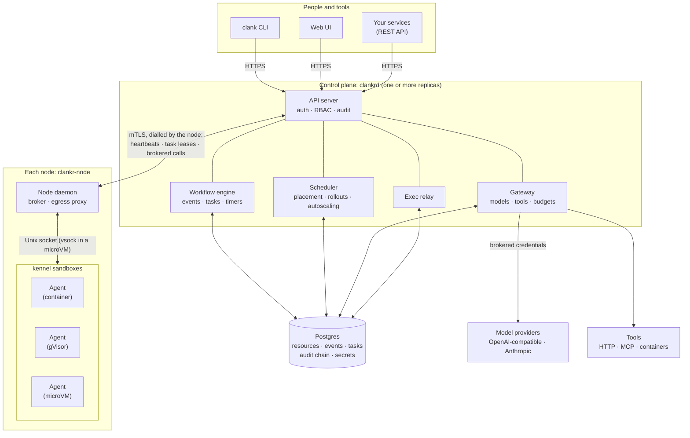
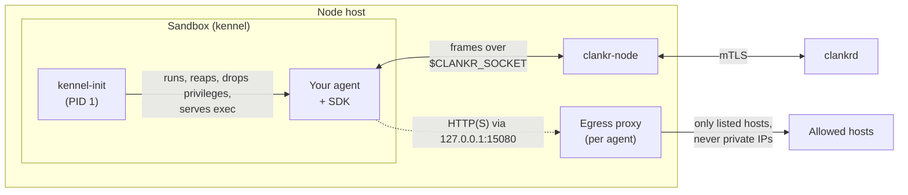
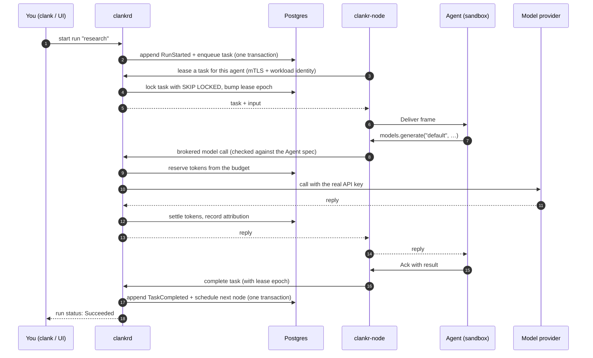

# Clankr

**An orchestration engine for AI agents, written in Rust.** Clankr runs agents the way a careful operator would: every agent sits in a sandbox, every step of every workflow is durably recorded, and every call an agent makes to a model or a tool goes through a gateway that checks it, meters it and writes it down.

There's no Kubernetes and no Temporal underneath. Clankr is one control-plane binary on top of Postgres, plus a small daemon on each machine that runs agents.

> **Status:** early and under active development (version 0.1.0). The core works end to end and is covered by integration tests, but APIs and resource schemas can still change. Don't put it in front of anything you can't afford to lose yet.

---

## Contents

- [Why Clankr exists](#why-clankr-exists)
- [What you get](#what-you-get)
- [Architecture](#architecture)
- [How a workflow runs](#how-a-workflow-runs)
- [Quick start](#quick-start)
- [Writing an agent](#writing-an-agent)
- [Core concepts](#core-concepts)
- [Security model](#security-model)
- [Operating Clankr](#operating-clankr)
- [Repository layout](#repository-layout)
- [Development](#development)
- [Design decisions](#design-decisions)
- [What isn't built yet](#what-isnt-built-yet)
- [License](#license)

---

## Why Clankr exists

Getting an agent to work in a notebook is easy. Running a fleet of them for real is a different problem:

- **Agents crash, nodes die, and models time out.** A three-hour research job shouldn't start over because a laptop went to sleep.
- **Agents run code you didn't write.** They install packages, browse the web and call tools. That code needs a real sandbox, not a polite request to behave.
- **Model calls cost money,** and a runaway loop can spend a month's budget in an afternoon.
- **Some actions need a human,** such as publishing, paying or deleting things. They should wait for a person and leave a record of who said yes.
- **When something goes wrong, you need to know exactly what happened:** which step, which model call, which tool, and who approved it.

Clankr treats all of these as platform problems rather than leaving each agent to solve them on its own. You describe agents and workflows as resources, much as you would with Kubernetes, and Clankr keeps them running, contained and accounted for.

## What you get

**Durable workflows**
- Workflows are declarative graphs. Nodes can be agent steps, tool calls, conditions, joins, timers, signals and human approvals.
- Every state change is an event committed to Postgres in the same transaction as the work it schedules. A crash at any point resumes exactly where it stopped.
- Time travel: look at a run as it was after any event, or fork a new run from any point in its history.

**Sandboxed agents**
- Agents ship as OCI images and run under kennel (Clankr's sister project, a separate repository), in one of three isolation levels: a rootless container, a gVisor sandbox, or a Firecracker microVM.
- By default an agent has no network at all. It reaches the outside world only through a per-agent egress proxy that allows listed hosts, or through a filtered NAT mode that a NetworkPolicy must explicitly allow.
- Each agent runs read-only, as an unprivileged user, with memory, CPU and process limits.

**A gateway for models and tools**
- Agents never hold API keys. They ask for a model by a claim name, and the gateway brokers the real credential.
- Built-in adapters for OpenAI-compatible APIs and Anthropic, with token budgets reserved before each call and settled after it.
- Tools can be HTTP endpoints, sandboxed containers or MCP servers, each with allow/deny grants, input schemas, idempotent replay and optional human approval.

**A fleet**
- Nodes join the cluster with a join token and mutual TLS, and the scheduler places agent instances on them.
- Deployments support rolling updates, canary releases, autoscaling from queue depth (including scale to zero), hibernation and draining nodes for maintenance.
- Multiple control-plane replicas can share one Postgres for high availability, and runs can be placed on other clusters.

**Governance**
- Role-based access control, with ServiceAccount tokens and OIDC sign-in for people.
- Quotas and budgets per namespace, with alerts.
- An approval inbox for steps that need a human.
- A tamper-evident audit log (hash-chained, append-only) that records every privileged action, including every denial.
- Signed images: agents can be required to come from images signed with a trusted key (cosign-compatible).

**Day-to-day tools**
- `clank`, the command-line client: apply manifests, start and inspect runs, shell into a running agent, manage secrets, run evaluations, and more.
- A web UI built into the control plane: runs, agents, workflows, memory, budgets, access and the audit log.
- Agent SDKs for **Python**, **TypeScript** and **Go**.
- Shared agent memory ("context") with versioned writes, snapshots and restore.
- Durable mailboxes for agent-to-agent messages.
- Evaluation suites that gate a release on quality thresholds, and image promotion through stages.
- OpenTelemetry tracing, backups with verified restore, and master-key rotation.

---

## Architecture

Clankr has two kinds of process: one **control plane** (`clankrd`, which can run as several replicas) and a **node daemon** (`clankr-node`) on each machine that runs agents. All shared state lives in Postgres, and nothing important lives only in memory.



A few things about this picture matter more than they look:

- **Nodes always dial the control plane, never the other way round.** A node can sit behind NAT, and the control plane never needs credentials for it. Even `clank exec` (a shell into a running agent) works this way: the node picks up the session from its next heartbeat.
- **Agents only ever talk to their own node,** over a Unix socket mounted into the sandbox. The node checks each call against the agent's spec before forwarding it, so an agent can't use a model, tool or mailbox it wasn't given, even if it replaces the SDK.
- **Postgres is the source of truth and the message bus.** Task dispatch uses `FOR UPDATE SKIP LOCKED`, wake-ups use `LISTEN/NOTIFY`, and leader election uses lease rows. There's no separate broker to run.
- **Every lease is fenced by an epoch.** A node that lost an instance, or a worker whose lease expired, can't commit stale results: the database refuses the write.

### Inside a node



`kennel-init` is a tiny static binary that runs as PID 1 inside every sandbox. It drops the agent to an unprivileged user, forwards signals, reaps zombies and serves `kennel exec`. In a microVM it also boots the guest (network, modules, volumes) and relays the agent's socket over vsock.

---

## How a workflow runs

Here's one agent step from start to finish. A crash at any point in this sequence is safe, because each arrow that changes state is a single Postgres transaction.



Because a run's state is just the fold of its events, replaying a run never calls a model or a tool again. That's what makes history views, time travel and forking cheap and safe.

---

## Quick start

### What you need

| | Required for | Notes |
|---|---|---|
| **Linux** | everything | Developed on Ubuntu 24.04+. Agent sandboxes use Linux namespaces and cgroups v2. |
| **Rust** (stable, edition 2024) | building | `rustup` is the easiest way to get it. |
| **kennel** | running agents as OCI images | The sister repository. Check it out next to this one, as `../kennel`. |
| **AppArmor profile** | Ubuntu 24.04+ | Ubuntu blocks unprivileged user namespaces by default; kennel ships a profile (`deploy/apparmor/kennel-dev`). |
| `pasta` | direct-network agents, microVM networking | From the `passt` package. |
| `runsc` | gVisor sandboxes (optional) | |
| `firecracker` + a guest kernel | microVM sandboxes (optional) | Point `KENNEL_VM_KERNEL` at the kernel. |
| Python 3, Node 22.18+ or Go 1.24 | writing agents | Only the SDK you use. |

You don't need to install Postgres. `clankrd --dev` downloads and runs a private one for you.

### 1. Build

With the `clankr` and `kennel` checkouts side by side:

```bash
cd kennel && cargo build && cargo build -p kennel-init --release --target x86_64-unknown-linux-musl
cd ../clankr && cargo build
```

On Ubuntu 24.04 or later, allow kennel to create user namespaces:

```bash
sudo cp ../kennel/deploy/apparmor/kennel-dev /etc/apparmor.d/ && sudo apparmor_parser -r /etc/apparmor.d/kennel-dev
```

### 2. Start the control plane

```bash
./target/debug/clankrd --dev
```

On first start, `clankrd` creates everything it needs:

- An embedded Postgres under `~/.local/share/clankr/pg`.
- A cluster certificate authority in `~/.local/share/clankr/pki`.
- An encryption key for secrets, `~/.local/share/clankr/master.key`. **Back this up**: without it, stored secrets can't be read.
- An owner token in `~/.config/clankr/token` (the break-glass admin), and a node join token in `~/.config/clankr/join-token`.

It then serves the API and the web UI on `https://127.0.0.1:7600`. The `clank` CLI finds the token and CA on its own. Put it on your `PATH` (for example, `ln -s $PWD/target/debug/clank ~/.local/bin/clank`) and check:

```bash
clank whoami
```

### 3. Add a node

```bash
./target/debug/clankr-node \
  --server https://127.0.0.1:7600 \
  --join-token "$(cat ~/.config/clankr/join-token)" \
  --ca-cert ~/.local/share/clankr/pki/ca.crt \
  --runtimes process,oci,oci/gvisor \
  --kennel ../kennel/target/debug/kennel

clank nodes
```

```
NAME     STATUS   MEMORY   CPUS   RUNTIMES                  INSTANCES
laptop   Ready    4096Mi   2.0    process,oci,oci/gvisor    -
```

### 4. Run something

Save this as `hello.yaml`. It defines a mock model provider (so you don't need an API key), a model claim, an agent, a deployment and a one-step workflow:

```yaml
apiVersion: clankr.io/v1alpha1
kind: ProviderConnection
metadata: { name: mock, namespace: demo }
spec: { provider: mock, allowedModels: [mock-1] }
---
apiVersion: clankr.io/v1alpha1
kind: ModelClaim
metadata: { name: default, namespace: demo }
spec: { providerConnection: mock, model: mock-1 }
---
apiVersion: clankr.io/v1alpha1
kind: Agent
metadata: { name: writer, namespace: demo }
spec:
  runtime:
    type: process
    command: [python3, /path/to/agent.py]   # see "Writing an agent" below
    env: { PYTHONPATH: /path/to/clankr/sdk/python }
  models: [default]
---
apiVersion: clankr.io/v1alpha1
kind: AgentDeployment
metadata: { name: writer, namespace: demo }
spec: { agent: writer, replicas: 1 }
---
apiVersion: clankr.io/v1alpha1
kind: Workflow
metadata: { name: hello, namespace: demo }
spec:
  entrypoint: write
  nodes:
    write: { type: agent, agentRef: writer }
```

```bash
clank apply -f hello.yaml
clank run start hello -n demo --input '{"topic": "durable agents"}'
clank run list -n demo
```

The `process` runtime is the quickest way to try things, but it isn't sandboxed. For real work, build an image and use `runtime: {type: oci, image: …, class: gvisor}`; see [Runtime classes](#runtime-classes).

Open `https://127.0.0.1:7600` in a browser and paste your token to watch the run in the UI. Your browser will warn about the certificate, because it's signed by your cluster's own CA.

---

## Writing an agent

An agent is an ordinary program that uses a Clankr SDK. It registers a handler per workflow node (or `"*"` for all of them), and Clankr delivers tasks to it.

**Python**

```python
from clankr import AgentApp, Permanent

app = AgentApp()

@app.task("write")
async def write(task, ctx):
    topic = task.input["input"]["topic"]
    reply = await ctx.models.generate("default", [{"role": "user", "content": f"Write about {topic}"}])
    return {"draft": reply["text"]}

app.run()
```

**TypeScript** (Node 22.18+ runs the `.ts` file directly, no build step)

```ts
import { AgentApp } from "@clankr/sdk"

const app = new AgentApp()
app.task("write", async (task, ctx) => {
  const reply = await ctx.models.generate("default", [{ role: "user", content: `Write about ${task.input.input.topic}` }])
  return { draft: reply.text }
})
app.run()
```

There's a Go SDK too (`sdk/go`, standard library only) with the same shape.

**A few rules of the road:**

- **Delivery is at-least-once.** A task can be delivered again after a crash or a timeout, so make handlers idempotent. Pass `task.idempotency_key` to external systems that can deduplicate. Tool calls made through `ctx.tools.call` get a stable key automatically, so a retried task gets the recorded result instead of calling the tool twice.
- **Raise `Permanent`** to fail a task without retrying it. Any other error is retried according to the workflow's retry policy.
- **The agent holds no credentials.** Models, tools, context and mailboxes are all reached through the node, which checks each call against the Agent spec. If the spec doesn't list it, the agent can't use it.
- **Hibernation hooks** (`onHibernate`) let an agent save a checkpoint when its deployment is put to sleep, and get it back on wake.

### Packaging an agent as an image

Agent images are built with kennel from a `Kennelfile`, which uses familiar Dockerfile syntax. The SDK directories ship base images (`clankr/agent-python`, `clankr/agent-node`, and a browser image with Chromium):

```dockerfile
FROM clankr/agent-node@sha256:…
COPY agent.ts /app/agent.ts
AGENT_ENTRYPOINT ["node", "/app/agent.ts"]
```

```bash
kennel build -t demo/writer:1 ./my-agent
```

Then point the Agent at the image, pinned by digest:

```yaml
spec:
  runtime: { type: oci, image: "demo/writer@sha256:…", class: gvisor }
```

---

## Core concepts

Everything in Clankr is a **resource**: a YAML or JSON document with `apiVersion`, `kind`, `metadata` and `spec`, stored in a namespace. You create and change resources with `clank apply`, and controllers make the world match.

| Resource | What it's for |
|---|---|
| `Agent` | What to run (process or OCI image), its runtime class, resources, and which models, tools, contexts, mailboxes and volumes it may use. |
| `AgentDeployment` | How many instances of an agent to keep running, plus rollout, canary, autoscaling and hibernation settings. |
| `Workflow` | A graph of nodes. Each run of it is a `WorkflowRun` with its own event history. |
| `ProviderConnection` / `ModelClaim` | A model provider with its brokered credential, and the named handle agents use for a model. |
| `Tool` / `ToolClaim` | A tool (HTTP, sandboxed container or MCP server) and the grants that let agents call it. |
| `ContextClaim` | A shared, versioned key-value memory with snapshots and point-in-time reads. |
| `AgentMailbox` | A durable queue for messages between agents. |
| `VolumeClaim` | Persistent storage for an agent, local to the node it binds to. |
| `NetworkPolicy` | Whether agents in a namespace may have direct network access, and to which private ranges. |
| `ImagePolicy` | Which registries and runtime classes are allowed, and whether images must be signed. |
| `AgentImage` | An image's promotion through stages (for example dev → staging → prod), with history and rollback. |
| `ServiceAccount` / `RoleBinding` | Machine identities, and the roles people and machines get. |
| `ResourceQuota` / `AgentBudget` | Limits on compute and spend per namespace. |

### Workflow nodes

| Node type | What it does |
|---|---|
| `agent` | Runs a task on an agent (queue `agent/<agentRef>`). |
| `activity` | Calls a tool directly (queue `tool/<toolRef>`). |
| `condition` | Branches on a value in the run's data, such as `$.verify.ok`. |
| `join` | Waits for all (or any) incoming branches. |
| `timer` | Waits for a duration, such as `30m`. |
| `signal` | Waits for a named signal from outside. |
| `approval` | Waits for a person in an approver group to approve or reject, with an optional timeout and a rejection path. |

Nodes connect with `next`, and steps can carry retry policies and side-effect classes. A step marked as having unsafe side effects is never blindly retried: if its outcome is unknown, the run waits for someone to resolve it.

### Runtime classes

| Class | Isolation | When to use it |
|---|---|---|
| `process` | None: a host process | Local development only. |
| `container` | Rootless Linux container (libcontainer): namespaces, seccomp, dropped capabilities, read-only root | Trusted code. The default for `oci`. |
| `gvisor` | gVisor's user-space kernel between the agent and the host | Untrusted code. A good default for agents that run tools. |
| `microvm` | A Firecracker VM with its own kernel | The strongest isolation, for the least trusted code. |

Direct network access (`network: direct`) is only allowed for `gvisor` and `microvm`.

---

## Security model

Clankr assumes the agent and its SDK are **untrusted**. Defences are layered so that no single mistake gives an agent more than it was granted.

| Layer | What it enforces |
|---|---|
| **Identity** | Nodes authenticate with mutual TLS certificates issued at join. Each agent instance gets a short-lived workload token (2 minutes, renewed with every heartbeat) bound to its namespace, agent, instance, node and placement epoch. A node that lost an instance is refused at once. |
| **Authorization** | Roles (viewer, editor, approver, admin, cluster-admin) are bound to users and ServiceAccounts. Node credentials can call only the node API, and only for their own instances. |
| **Admission** | Resources are validated on write: image policies, runtime classes, network policies, quotas. The node checks again before every launch. |
| **Sandbox** | Read-only root, unprivileged user, seccomp, no new privileges, cgroup limits, and gVisor or a VM for stronger isolation. |
| **Network** | No network by default. Egress goes through a per-agent proxy that allows listed hosts only and refuses private, loopback and cloud-metadata addresses. Direct NAT mode needs a NetworkPolicy, and logs every connection with its verdict. |
| **Credentials** | Provider and tool keys are encrypted at rest (AES-256-GCM) and decrypted only inside the gateway. They never appear in images, environment variables, logs or prompts, and every decryption is audited. |
| **Audit** | Every privileged action and every denial is written to a hash-chained, append-only audit log. `clank exec` sessions are audited before they start. |

---

## Operating Clankr

**Day-to-day commands**

```bash
clank get agents -n demo                 # list resources
clank run get <run-id> -n demo           # a run's status
clank run history <run-id> -n demo       # its full event history
clank run fork <run-id> --at 7 -n demo   # a new run from event 7 onward
clank approvals                          # what's waiting on a human
clank exec -n demo writer -t             # a shell inside a running agent (admins only, audited)
clank node drain <name>                  # move instances off a node before maintenance
clank hibernate writer -n demo           # checkpoint and release compute; --resume to wake
clank usage -n demo                      # quotas, budgets and spend
```

**Running in production**

- Point `clankrd` at a real Postgres with `DATABASE_URL`, and run two or more replicas behind a load balancer. The replicas elect a leader for the scheduler and ticker, and any replica can serve any request, including every part of an exec session.
- **Back up regularly:** `clankrd backup <dir>` takes a consistent snapshot, and `clankrd restore` plus `clankrd verify` prove the copy before you rely on it. Keep the master key escrowed separately. See [the backup and restore runbook](docs/runbooks/backup-restore.md).
- **Rotate the master key** with `clankrd rotate-master-key`. It re-encrypts every secret in one transaction and keeps the old key for restoring older backups.
- **Tracing:** set `OTEL_EXPORTER_OTLP_ENDPOINT` to send OpenTelemetry traces to your collector.
- **Sign-in for people:** set `CLANKR_OIDC_ISSUER` and `CLANKR_OIDC_AUDIENCE` to let people sign in through your identity provider (`clank login` uses the device flow).

---

## Repository layout

```
clankr/
├── crates/
│   ├── clankrd/          the control plane: API, engine, scheduler, gateway, web UI, exec relay
│   ├── clankr-node/      the node daemon: joins the fleet, runs agents under kennel, brokers their calls
│   ├── clank/            the command-line client
│   ├── clankr-engine/    workflow graphs, the event-sourced interpreter, task dispatch, timers, approvals
│   ├── clankr-store/     Postgres schema and migrations, resources, events, audit chain, secrets, context
│   ├── clankr-gateway/   model and tool gateway: provider adapters, budgets, grants, approvals
│   ├── clankr-sandbox/   runs tool calls (and MCP servers) in fresh kennel containers
│   ├── clankr-tls/       the cluster CA and certificates
│   └── clankr-types/     shared types: resources, agent specs, RBAC, the agent wire protocol
├── sdk/
│   ├── python/           Python SDK and base image
│   ├── typescript/       TypeScript SDK, base image and browser image
│   └── go/               Go SDK
├── ui/                   the web UI (React + Vite), built into clankrd
├── docs/
│   ├── adr/              one short document per design decision (30 so far)
│   └── runbooks/         operational procedures
└── IMPLEMENTATION_PLAN.md
```

---

## Development

```bash
cargo build                                   # everything
cargo test -p clankrd                         # one crate's tests
cargo test -p clank --test exec_e2e           # one end-to-end test
cargo clippy --all-targets
```

- **The tests are real integration tests.** They start an embedded Postgres, a TLS control plane, fleet nodes and, where available, real sandboxes.
- **Tests that need something you don't have skip themselves** and say why: kennel, gVisor, Firecracker, a network connection, or a base image.
- **On a smaller machine,** keep builds and tests gentle, for example `cargo build -j 2` and `cargo test -- --test-threads 2`.
- **The web UI** lives in `ui/`. Build it with `npm install && npm run build`; `clankrd` embeds `ui/dist` at compile time.

---

## Design decisions

Each significant choice is written down as a short ADR in [`docs/adr`](docs/adr). The ones that shape the system most:

| ADR | Decision |
|---|---|
| [0001](docs/adr/0001-postgres-only-store.md) | Postgres is the only store: resources, events, queues, leases and notifications. |
| [0005](docs/adr/0005-yaml-graph-dsl.md) | Workflows are declarative graphs, so replay is a pure function of the events. |
| [0007](docs/adr/0007-kennel-separate-project.md) | Image building and sandboxing live in a separate project, kennel. |
| [0008](docs/adr/0008-cluster-scheduling.md) | Scheduling with leases fenced by epochs, so a stale node can never commit. |
| [0011](docs/adr/0011-rbac.md) | Role-based access control and ServiceAccounts. |
| [0018](docs/adr/0018-tool-gateway.md) | The tool gateway: grants, idempotent replay and approvals. |
| [0024](docs/adr/0024-runtime-classes.md) | Three runtime classes: container, gVisor and microVM. |
| [0027](docs/adr/0027-egress-proxy.md) | No network by default; egress only through a per-agent proxy. |
| [0029](docs/adr/0029-direct-network-mode.md) | Direct network access, only when a NetworkPolicy allows it. |
| [0030](docs/adr/0030-clank-exec.md) | `clank exec`: audited shells into agents, relayed through the control plane. |

[`IMPLEMENTATION_PLAN.md`](IMPLEMENTATION_PLAN.md) maps the product requirements to what's been built and how.

---

## What isn't built yet

Clankr is honest about its gaps. The biggest ones right now:

- **Agent-to-agent messaging beyond mailboxes:** logical service addresses (`AgentService`), pub/sub topics with durable subscriptions, request/reply, and pushing messages into handlers instead of polling.
- **Restart budgets for crash-looping agents:** today they're restarted indefinitely, with capped backoff.
- **Shipping the audit log off-site,** so that even a database superuser can't quietly remove rows.
- **Envelope encryption and KMS support for secrets:** today one master key encrypts them all.
- **Many resource kinds from the product requirements** are recognised by the type system but don't have controllers yet.

Smaller, deliberate shortcuts are marked in the code with `ponytail:` comments. Each one names its limit and what the upgrade path would be.

---

## License

Apache-2.0.
